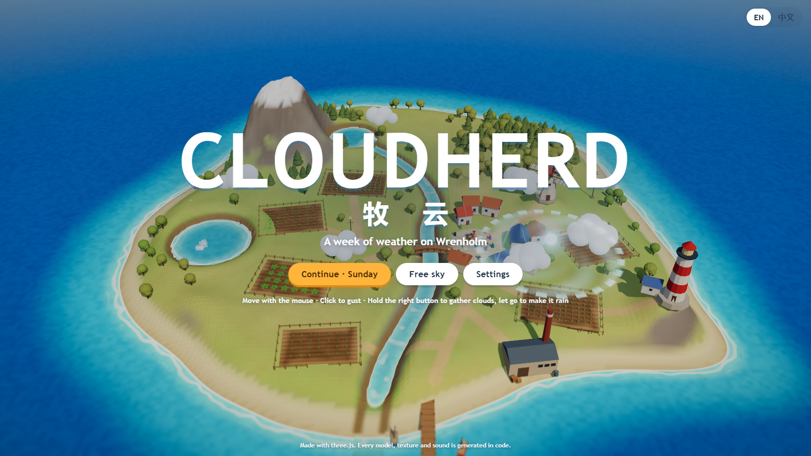
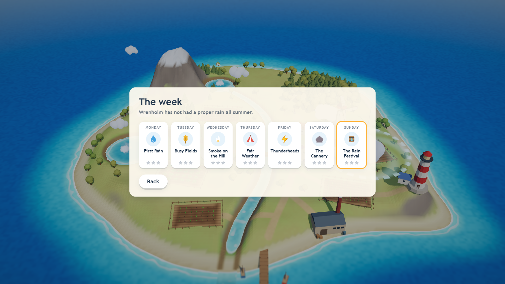
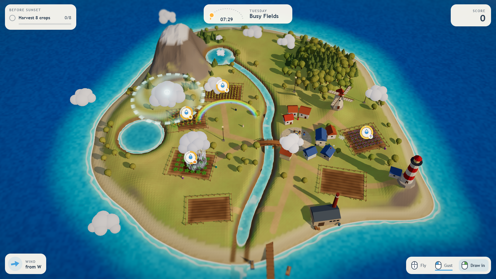
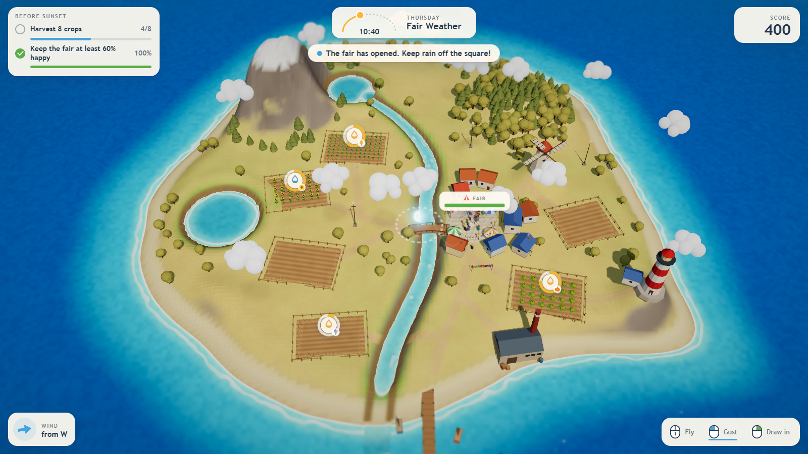
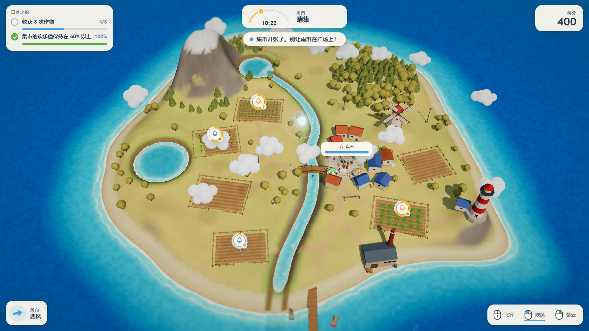

# CLOUDHERD · 牧云

**简体中文** | [English](#english)



一款用 three.js 写成的天气放牧游戏，整个游戏就是一个 HTML 文件。小岛、房子、云、雨、闪电、音效和音乐全部由代码生成，没有任何图片、模型或音频素材文件。

雀屿一整个夏天都没好好下过一场雨。你是一阵年轻的风：把云赶到一起、带到田地上空，再松手让它下雨。一周七天，每天日出到日落。

## 怎么玩

用 Chrome 或 Edge 打开 [`cloudherd.html`](cloudherd.html) 即可，不需要安装，也不需要联网。推荐用鼠标玩；触屏只有基础支持（单指移动，轻点吹风，第二根手指按住聚云）。

| 操作 | 效果 |
|---|---|
| 移动鼠标（或 WASD / 方向键） | 飞行。飞进云里会推着它走 |
| 左键（或空格） | 吹风：把前方的云吹远，也能吹散烟雾 |
| 按住右键（或 Shift） | 聚云：把附近的云吸过来合在一起。被吸住的云不会下雨 |
| 松开右键 | 三朵以上的云合成的雨云会就地下雨 |
| Esc 或 P | 暂停（暂停菜单里有操作说明） |
| F | 切换全屏 |

界面语言（简体中文 / English）可以在标题画面右上角或设置里切换，首次打开时跟随浏览器语言。

## 核心规则

- **云会合并。** 三朵小云合成一朵雨云；七朵以上会变成雷云，雷云会不断劈下闪电，可能点燃干燥的树林或房子。
- **按住才不下雨。** 聚云时被吸住的云会憋着雨，松手后才倾盆而下。已经在下雨的云吸不动了，只能推或吹。
- **土地会变干。** 雨落在哪里，哪里的土就变深、草就变绿；太阳会把它慢慢晒干，正午最快。每块田上方的徽章显示土壤湿度（水滴）和作物生长（外圈）。
- **作物各有脾气。** 小麦、向日葵、南瓜、薰衣草长得快慢不同，需要的水也不同，南瓜最能喝水。土太干会枯萎，农民过一会儿会重新播种。
- **水从哪里来。** 湖泊和山间小湖在太阳底下会不断冒出小云，海上的云会顺着风飘过来。飘出海面太远的云会散掉。

## 一周七天

| | 新内容 |
|---|---|
| 周一 · 初雨 | 教学关：飞行、推云、聚云、下雨、吹风 |
| 周二 · 田忙 | 四块田、四种作物，海上来云 |
| 周三 · 山火 | 低语林会自燃，风把火往村子吹，不能让房子烧掉 |
| 周四 · 晴集 | 广场上赶集，雨要绕开集市，也别淋湿晾着的衣服 |
| 周五 · 雷云 | 堆出雷云，吸住它停在避雷针上空接闪电，点亮灯塔 |
| 周六 · 罐头厂 | 烟囱吐出的烟雾吸不动，只能吹散或吹到海上；混进云里会下酸雨 |
| 周日 · 祈雨节 | 最干的一天，傍晚的祈雨节需要把雨下在广场上，装满雨桶后迎来一场大雨 |

每天日落时结算：完成全部目标即过关，分数决定一到三颗星。收获、正中目标的雨、抓到的彩虹（飞过彩虹即可）、扑灭的火都会加分；枯死的作物、烧毁的房子、淋湿的衣服会扣分。标题画面的「自由天空」没有时间和目标，所有田地都种上了，可以随意摆弄天气。

| | |
|---|---|
|  |  |
|  |  |
|  |  |
|  |  |
|  | |

## 已知情况

- 整整一周都由自动驾驶程序从头玩到尾过：它会聚云、带云、松手下雨、灭火、吹散烟雾、把雷云停在避雷针上空。教学关用真实的鼠标点击和移动走完过。还没有真人从头玩过。
- 自动驾驶分三档：熟练（全速飞行、立刻做决定）、普通（飞得慢、会犹豫、偶尔挑错要紧的事、松手位置不准、会走神歇一下）、生疏（这些毛病更重）。当前版本每格 5 局的过关率和平均星数：

  | | 熟练 | 普通 | 生疏 |
  |---|---|---|---|
  | 周一 | 5/5 · 2.8 星 | 5/5 · 2.6 星 | 5/5 · 2.4 星 |
  | 周二 | 5/5 · 2.8 星 | 5/5 · 1.8 星 | 5/5 · 2.0 星 |
  | 周三 | 5/5 · 2.2 星 | 5/5 · 2.2 星 | 5/5 · 2.0 星 |
  | 周四 | 5/5 · 2.6 星 | 5/5 · 1.8 星 | 5/5 · 1.8 星 |
  | 周五 | 10/11 · 2.6 星 | 5/5 · 2.2 星 | 2/5 · 0.8 星 |
  | 周六 | 5/5 · 2.8 星 | 5/5 · 1.6 星 | 4/5 · 1.2 星 |
  | 周日 | 5/5 · 2.4 星 | 4/5 · 2.0 星 | 3/5 · 0.8 星 |

  周五最难：要把雷云吸住停在避雷针上空才接得够闪电，这一行是加上这条提示之后重新测的。同一格重复测量波动不小。自动驾驶知道每朵云的确切位置，也从不看错屏幕，所以第一次玩的人会觉得后几天比表里更难；这些数字只能说明七天之间的相对难度。所有数值都在 `src/levels.js`。
- 设置里有「轻松模式」，土地干得慢 30%。
- 性能只在一台高端笔记本显卡上测过（约 4 毫秒一帧）。帧率持续过低时游戏会自动降低画质，但这条路径没有在低配机器上验证。
- 声音全部由 Web Audio 合成。自动化测试只确认了每个音效都能正常播放、不报错，没有经过真人试听。

## 从源码构建

需要 Node.js。

```bash
npm install        # 安装 esbuild、three.js 和 puppeteer-core
npm run build      # 生成 cloudherd.html（压缩版）
npm run dev        # 生成未压缩版，报错信息更易读
```

源码在 `src/`，`build.mjs` 用 esbuild 把它和 three.js 打包进一个 HTML 文件。所有界面文字（中英文）都在 `src/i18n.js`，七天的关卡数值在 `src/levels.js`，作物在 `src/crops.js`，岛的布局在 `src/island.js` 开头。

`tools/` 是无头浏览器测试脚本，需要本机装有 Chrome；Chrome 路径写在 `tools/shot.mjs` 里（也可以用环境变量 `CHROME` 指定）。

```bash
node tools/shot.mjs title                                   # 启动并截取标题画面
node tools/shot.mjs tools/sc-firstrun.mjs --notest=1        # 首次游玩：真实鼠标点击、走完教学
node tools/shot.mjs tools/sc-alldays.mjs                    # 依次运行七天，检查报错
node tools/shot.mjs tools/sc-bot.mjs --runs=5 --skill=0.5   # 自动驾驶在每一天打若干局，输出过关率和星级
node tools/shot.mjs tools/sc-checks.mjs                     # 音效、帧时间、进度解锁
node tools/shot.mjs tools/sc-readme.mjs                     # 重新生成 README 截图
```

## 第三方组件

`cloudherd.html` 内含 [three.js](https://threejs.org/)（MIT 许可），许可全文见 [`THIRD_PARTY_NOTICES.md`](THIRD_PARTY_NOTICES.md)。

---

<a id="english"></a>

# CLOUDHERD

[简体中文](#cloudherd--牧云) | **English**

A weather-herding game written with three.js, shipped as a single HTML file. The island, the houses, the clouds, rain, lightning, every sound and the music are generated in code. There are no image, model or audio asset files.

Wrenholm has not had a proper rain all summer. You are a young wind: round up clouds, carry them over the fields and let go so they rain. Seven days, each one from sunrise to sunset.

## How to play

Open [`cloudherd.html`](cloudherd.html) in Chrome or Edge. Nothing to install, no network needed. A mouse is recommended; touch support is basic (one finger steers, a tap gusts, a second finger held down gathers).

| Input | What it does |
|---|---|
| Move the mouse (or WASD / arrow keys) | Fly. Flying into a cloud pushes it along |
| Left click (or Space) | Gust: blows clouds ahead of you far away, and breaks up smog |
| Hold the right button (or Shift) | Gather: pulls nearby clouds in and merges them. A cloud you are holding does not rain |
| Let go of the right button | A rain cloud made of three or more clouds pours where it is |
| Esc or P | Pause (the pause menu lists the controls) |
| F | Toggle fullscreen |

The interface language (English / 简体中文) can be switched in the title screen's corner or in Settings. On first run it follows the browser's language.

## The rules

- **Clouds merge.** Three small clouds make a rain cloud. Seven or more make a thunderhead, which keeps throwing lightning that can set dry woods or houses alight.
- **Holding keeps the rain in.** A cloud you are gathering holds its rain until you let go. A cloud that is already raining can no longer be gathered, only pushed or gusted.
- **The ground dries out.** Wherever rain falls the soil darkens and the grass greens; the sun dries it again, fastest at noon. The badge over each field shows soil moisture (the drop) and crop growth (the ring).
- **Each crop is different.** Wheat, sunflowers, pumpkins and lavender grow at different speeds and want different amounts of water; pumpkins drink the most. Crops left too dry wither, and the farmers replant after a while.
- **Where water comes from.** The lake and the mountain tarn keep breathing out small clouds while the sun is up, and clouds roll in off the sea with the wind. A cloud that drifts too far out to sea dissolves.

## The week

| | What is new |
|---|---|
| Monday · First Rain | Tutorial: flying, pushing, gathering, rain, gusts |
| Tuesday · Busy Fields | Four fields, four crops, clouds off the sea |
| Wednesday · Smoke on the Hill | The Whisperwood catches fire and the wind carries it toward the village; no house may burn |
| Thursday · Fair Weather | A fair on the square that must stay dry, and laundry lines to keep dry too |
| Friday · Thunderheads | Build a thunderhead and hold it over a rod so the rod catches its lightning and lights the lighthouse |
| Saturday · The Cannery | Smog from the chimney cannot be gathered, only gusted apart or blown out to sea; mixed into a cloud it rains sour |
| Sunday · The Rain Festival | The driest day. The evening festival wants rain on the square; fill the barrel and the Great Rain comes |

Each day is scored at sunset: meet every goal to pass, and the score decides one to three stars. Harvests, rain right on target, caught rainbows (fly through one), and doused fires add points; withered crops, burned houses and soaked laundry take points away. Free Sky, on the title screen, has no clock and no goals, every field planted, and weather to play with.

| | |
|---|---|
|  |  |
|  |  |
|  |  |
|  |  |
|  | |

## Known state

- The whole week has been played end to end by an automated pilot that gathers clouds, carries them, lets go over the fields, puts out fires, gusts smog away and holds thunderheads over the rods. The tutorial has been run with real mouse movement and clicks. Nobody has played it by hand yet.
- The pilot has three skill levels: expert (full speed, instant decisions), average (flies slower, hesitates, sometimes picks the wrong job, drops clouds less precisely, takes short breaks) and clumsy (more of all of that). Pass rate and average stars on this build, 5 runs per cell:

  | | Expert | Average | Clumsy |
  |---|---|---|---|
  | Monday | 5/5 · 2.8 stars | 5/5 · 2.6 stars | 5/5 · 2.4 stars |
  | Tuesday | 5/5 · 2.8 stars | 5/5 · 1.8 stars | 5/5 · 2.0 stars |
  | Wednesday | 5/5 · 2.2 stars | 5/5 · 2.2 stars | 5/5 · 2.0 stars |
  | Thursday | 5/5 · 2.6 stars | 5/5 · 1.8 stars | 5/5 · 1.8 stars |
  | Friday | 10/11 · 2.6 stars | 5/5 · 2.2 stars | 2/5 · 0.8 stars |
  | Saturday | 5/5 · 2.8 stars | 5/5 · 1.6 stars | 4/5 · 1.2 stars |
  | Sunday | 5/5 · 2.4 stars | 4/5 · 2.0 stars | 3/5 · 0.8 stars |

  Friday is the hardest: you have to hold a thunderhead over a rod to catch enough bolts, and that row was measured again after the day's intro started saying so. Repeat measurements of one cell swing noticeably. The pilot knows exactly where every cloud is and never misreads the screen, so a first-time player will likely find the later days harder than this; the numbers only show how the days sit relative to each other. Every knob is in `src/levels.js`.
- Settings has a Relaxed mode in which the ground dries 30% slower.
- Performance was measured on one high-end laptop GPU only (about 4 ms a frame). The game steps quality down if the frame rate stays low, but that path is unverified on weak hardware.
- All sound is synthesised with Web Audio. The automated checks only confirm that every effect plays without errors; nobody has listened to it.

## Building from source

Requires Node.js.

```bash
npm install        # installs esbuild, three.js and puppeteer-core
npm run build      # writes cloudherd.html (minified)
npm run dev        # unminified build with readable errors
```

The source is in `src/`. `build.mjs` uses esbuild to bundle it with three.js into one HTML file. All interface text, in both languages, lives in `src/i18n.js`; the seven days' numbers are in `src/levels.js`, the crops in `src/crops.js`, and the island layout at the top of `src/island.js`.

`tools/` holds headless-browser test scripts. They need Chrome installed; its path is set in `tools/shot.mjs` (or set the `CHROME` environment variable).

```bash
node tools/shot.mjs title                                   # boot and screenshot the title
node tools/shot.mjs tools/sc-firstrun.mjs --notest=1        # first run: real mouse clicks through the tutorial
node tools/shot.mjs tools/sc-alldays.mjs                    # run all seven days and check for errors
node tools/shot.mjs tools/sc-bot.mjs --runs=5 --skill=0.5   # the autopilot plays every day and reports pass rates and stars
node tools/shot.mjs tools/sc-checks.mjs                     # sounds, frame time, progress unlocking
node tools/shot.mjs tools/sc-readme.mjs                     # regenerate the README screenshots
```

## Third-party

`cloudherd.html` bundles [three.js](https://threejs.org/) (MIT License). The full notice is in [`THIRD_PARTY_NOTICES.md`](THIRD_PARTY_NOTICES.md).
