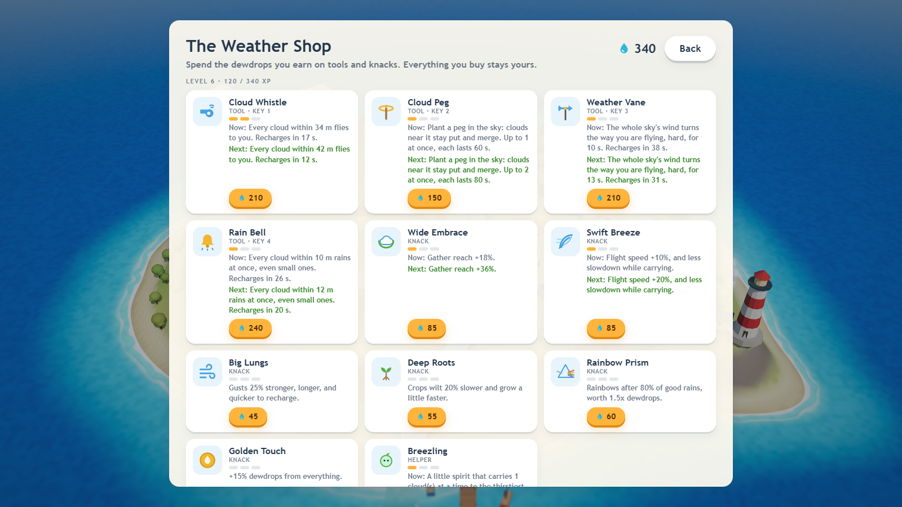
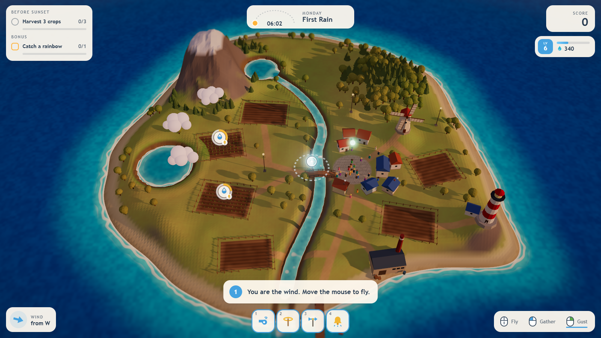
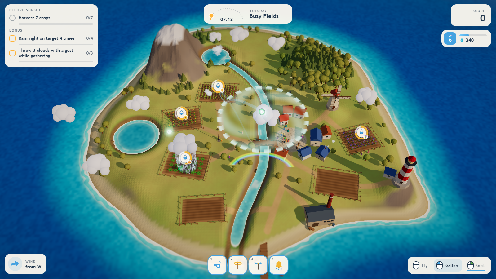
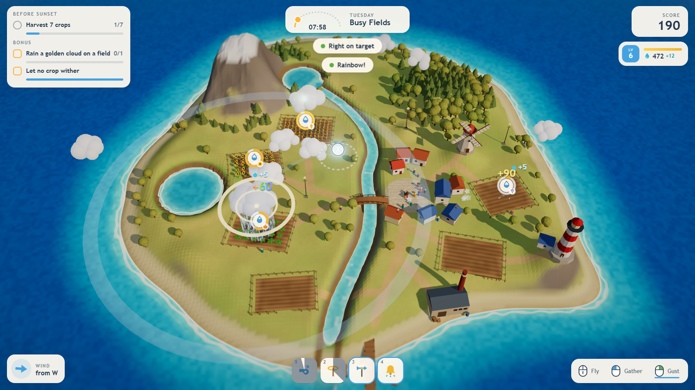
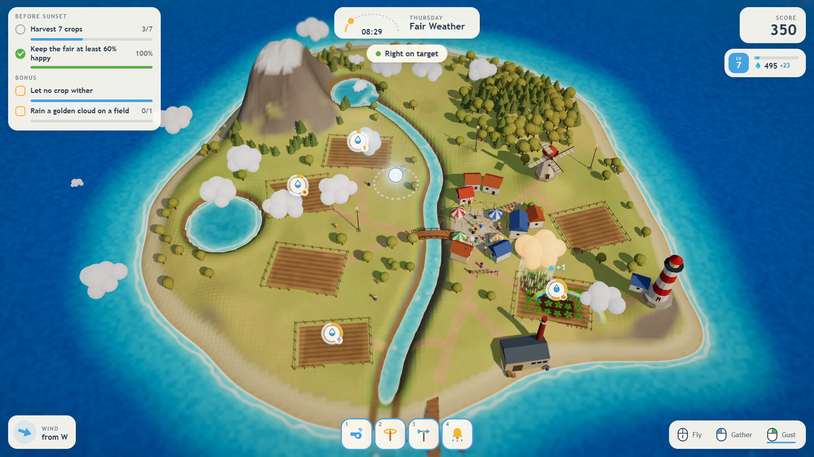
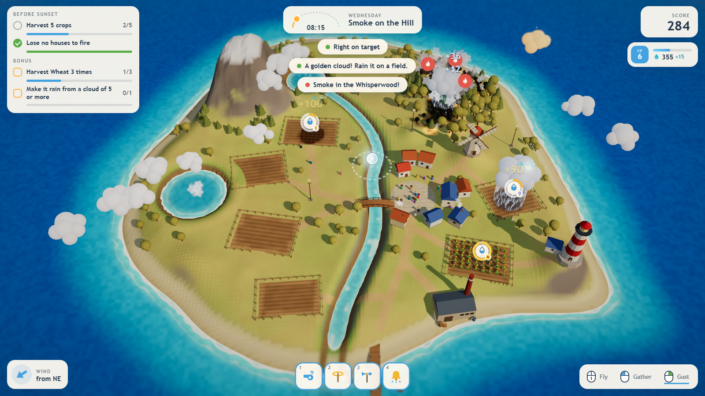
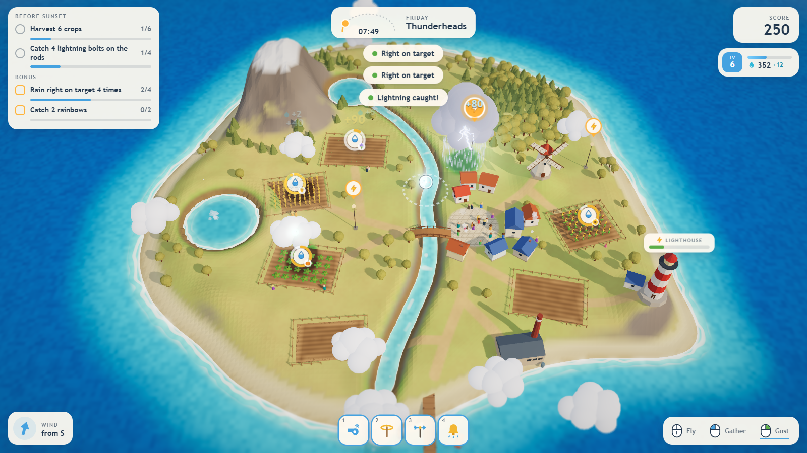
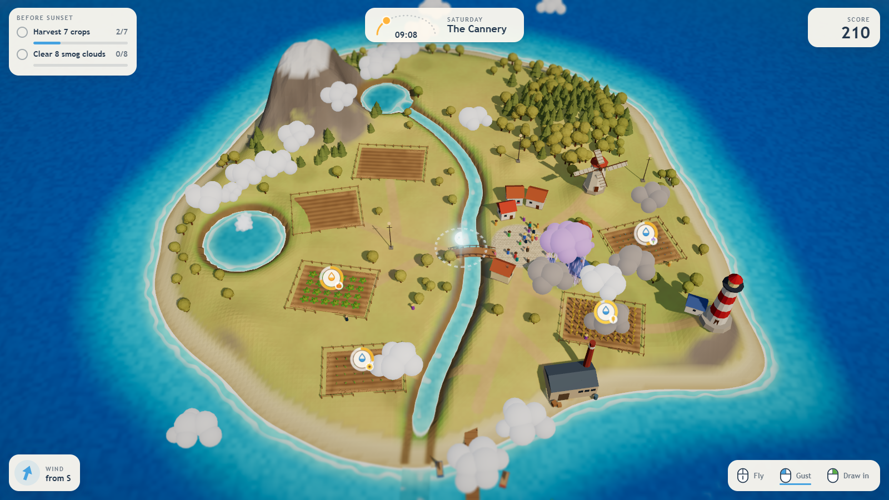
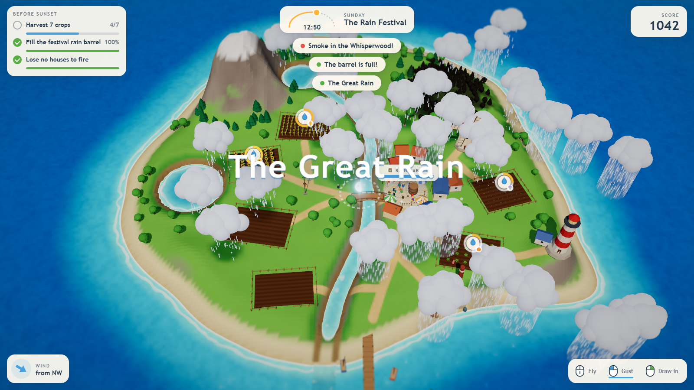

# CLOUDHERD · 牧云

**简体中文** | [English](#english)


一款用 three.js 写成的天气放牧游戏，整个游戏就是一个 HTML 文件。小岛、房子、云、雨、闪电、音效和音乐全部由代码生成，没有任何图片、模型或音频素材文件。

雀屿一整个夏天都没好好下过一场雨。你是一阵年轻的风：把云聚到一起、带到田地上空，再松手让它下雨。一周七天，每天日出到日落。赚到的露珠可以在天气小铺里买道具和本领，你的风也会一级一级变强。

## 怎么玩

用 Chrome 或 Edge 打开 [`cloudherd.html`](cloudherd.html) 即可，不需要安装，也不需要联网。推荐用鼠标玩；触屏会在第一次触摸时显示「聚云」「吹风」两个按钮。

| 操作 | 效果 |
|---|---|
| 移动鼠标（或 WASD / 方向键） | 飞行，风会紧跟着光标。飞进云里会推着它走 |
| 按住左键（或 Shift；按 E 切换） | 聚云：附近的云会被牢牢抓住、跟着你飞并合在一起。被抓住的云憋着雨 |
| 松开左键 | 云停在原地；三朵以上合成的雨云会就地下雨 |
| 右键（或空格） | 吹风：把前方的云吹远、吹散烟雾。聚云时吹风会把抓着的云扔出去 |
| 1 2 3 4 | 使用在商店买的道具 |
| Esc 或 P | 暂停（暂停菜单里有操作说明） |
| F | 切换全屏 |

默认不用右键拖动，因为有些浏览器会把右键拖动当成手势（比如后退）。设置里可以交换左右键、把聚云改成「点击切换」，还可以单独调整环境声（风、海、雨）的音量。界面语言（简体中文 / English）可以在标题画面右上角或设置里切换，首次打开时跟随浏览器语言。

## 核心规则

- **云会合并。** 三朵小云合成一朵雨云；七朵以上会变成雷云，雷云会不断劈下闪电，可能点燃干燥的树林或房子。
- **抓住才不下雨。** 被你抓住的云憋着雨、不会蒸发，带着它可以翻过山；松手后它就地停下，够大就倾盆而下。已经在下雨的云，只有在它正上方按下聚云才能重新抓起来。
- **土地会变干。** 雨落在哪里，哪里的土就变深、草就变绿；太阳会把它慢慢晒干，正午最快。每块田上方的徽章显示土壤湿度（水滴）和作物生长（外圈）。
- **作物各有脾气。** 小麦、向日葵、南瓜、薰衣草长得快慢不同，需要的水也不同，南瓜最能喝水。土太干会枯萎，农民过一会儿会重新播种。
- **水从哪里来。** 湖泊和山间小湖在太阳底下会不断冒出小云，海上的云会顺着风飘过来。飘出海面太远的云会散掉。偶尔会飘来**金色的云**：让它在田里下雨，作物会疯长，还会掉露珠。

## 成长：等级、露珠和天气小铺

- **经验和等级。** 收获、正中目标的雨、彩虹、扑灭的火都给经验。每升一级会自动得到一项小小的永久加成（聚云范围、飞行速度、吹风力量、作物耐旱、露珠收入，轮流获得），最高 20 级。
- **露珠是货币。** 收获的作物越值钱，给的露珠越多；彩虹、金色的雨、救下的房子、吹散的烟雾也给露珠。日落时还会按星数、首次通关和额外目标结算。中途退出或重来也会保留已经赚到的部分；自由天空里的收入减半。
- **额外目标。** 每天有两个随机的额外目标（例如抓到两道彩虹、用五朵以上合成的云下一场雨、不让任何作物枯死、收获某种作物几次），完成后多拿露珠和经验。
- **天气小铺**（本周地图上的「商店」）有三类东西，每样都能升到三级：
  - **道具（按 1–4 使用，有冷却）：** 唤云哨，把附近所有的云叫到身边；系云桩，在天上钉一根桩，附近的云会停住并合在一起；风向标，让整片天空的风朝你飞的方向猛吹一阵；雨铃，让身边的云立刻下雨，小云也行。
  - **本领：** 大大的怀抱（聚云范围）、轻快的风（飞行速度，带云时也快）、好肺活量（吹风）、深根（作物耐旱）、彩虹棱镜（彩虹更多、更值钱）、点露成金（露珠收入）。
  - **帮手：** 小风灵，会自己一朵一朵地把小云送到最缺水的田里。

## 一周七天

| | 新内容 |
|---|---|
| 周一 · 初雨 | 教学关：飞行、推云、聚云、下雨、吹风 |
| 周二 · 田忙 | 四块田、四种作物，海上来云 |
| 周三 · 山火 | 低语林会自燃，风把火往村子吹，不能让房子烧掉 |
| 周四 · 晴集 | 广场上赶集，雨要绕开集市，也别淋湿晾着的衣服 |
| 周五 · 雷云 | 堆出雷云，抓住它停在避雷针上空接闪电，点亮灯塔。三根避雷针头顶都有闪电标记，雷云够得着时标记会亮起来 |
| 周六 · 罐头厂 | 烟囱吐出的烟雾抓不住，只能吹散或吹到海上；混进云里会下酸雨 |
| 周日 · 祈雨节 | 最干的一天，傍晚的祈雨节需要把雨下在广场上，装满雨桶后迎来一场大雨 |

每天日落时结算：完成全部目标即过关，分数决定一到三颗星。标题画面的「自由天空」没有时间和目标，所有田地都种上了，可以随意摆弄天气。

| | |
|---|---|
|  |  |
|  |  |
|  |  |
|  |  |
|  |  |
|  |  |
|  | |

## 已知情况

- 整整一周都由自动驾驶程序从头玩到尾过：它会聚云、带云、松手下雨、灭火、吹散烟雾、把雷云停在避雷针上空，但不会用道具，也没有任何升级。教学关和新的操作（聚云、快速拖动、松手下雨、扔云、交换左右键、点击切换、触屏按钮）都用真实的鼠标和触摸事件测过。还没有真人从头玩过。
- 这一版的操作跟手了很多：风紧跟光标，抓住的云不会再被甩掉。自动驾驶在三档水平下每天都能过关（每格 3 局，63 局全部过关），星数大多是三颗，周五对生疏的自动驾驶最难。三星的分数线大约是熟练自动驾驶平均分的 85%，两星大约是 55%。完全不操作的话，周二只能收获 3 次，田会干死；只靠一级的小风灵大约能多收一倍，但过不了关。自动驾驶知道每朵云的确切位置，也从不看错屏幕，第一次玩的人会慢不少，道具和升级就是帮人慢慢追上来的。所有数值都在 `src/levels.js` 和 `src/profile.js`。
- 设置里有「轻松模式」，土地干得慢 30%。
- 性能只在一台高端笔记本显卡上测过（约 4 毫秒一帧）。帧率持续过低时游戏会自动降低画质，但这条路径没有在低配机器上验证。
- 声音全部由 Web Audio 合成。自动化测试只确认了每个音效都能正常播放、不报错，没有经过真人试听。
- 进度、等级、露珠和买到的东西都存在浏览器的本地存储里；清除网站数据会让它们一起消失。

## 从源码构建

需要 Node.js。

```bash
npm install        # 安装 esbuild、three.js 和 puppeteer-core
npm run build      # 生成 cloudherd.html（压缩版）
npm run dev        # 生成未压缩版，报错信息更易读
```

源码在 `src/`，`build.mjs` 用 esbuild 把它和 three.js 打包进一个 HTML 文件。所有界面文字（中英文）都在 `src/i18n.js`，七天的关卡数值在 `src/levels.js`，作物在 `src/crops.js`，商店、道具、等级和升级的数值在 `src/profile.js`，岛的布局在 `src/island.js` 开头。

`tools/` 是无头浏览器测试脚本，需要本机装有 Chrome；Chrome 路径写在 `tools/shot.mjs` 里（也可以用环境变量 `CHROME` 指定）。

```bash
node tools/shot.mjs title                                   # 启动并截取标题画面
node tools/shot.mjs tools/sc-firstrun.mjs --notest=1        # 首次游玩：真实鼠标点击、走完教学
node tools/shot.mjs tools/sc-gather.mjs                     # 真实鼠标聚云、快速拖动、松手下雨、扔云
node tools/shot.mjs tools/sc-tools.mjs                      # 商店购买、四种道具、小风灵和结算
node tools/shot.mjs tools/sc-rods.mjs                       # 避雷针标记、雷云够得着时的提示、周五介绍文字（加 --lang=zh 查中文）
node tools/shot.mjs tools/sc-alldays.mjs                    # 依次运行七天，检查报错
node tools/shot.mjs tools/sc-bot.mjs --runs=3 --skills=1,0.5,0.25   # 自动驾驶在每一天打若干局，输出过关率和星级
node tools/shot.mjs tools/sc-checks.mjs                     # 音效、帧时间、进度解锁
node tools/shot.mjs tools/sc-readme.mjs                     # 重新生成 README 截图
```

## 第三方组件

`cloudherd.html` 内含 [three.js](https://threejs.org/)（MIT 许可），许可全文见 [`THIRD_PARTY_NOTICES.md`](THIRD_PARTY_NOTICES.md)。

---

<a id="english"></a>

# CLOUDHERD

[简体中文](#cloudherd--牧云) | **English**

A weather-herding game written with three.js, shipped as a single HTML file. The island, the houses, the clouds, rain, lightning, every sound and the music are generated in code. There are no image, model or audio asset files.

Wrenholm has not had a proper rain all summer. You are a young wind: gather clouds, carry them over the fields and let go so they rain. Seven days, each one from sunrise to sunset. The dewdrops you earn buy tools and knacks in the Weather Shop, and your wind grows stronger level by level.

## How to play

Open [`cloudherd.html`](cloudherd.html) in Chrome or Edge. Nothing to install, no network needed. A mouse is recommended; on a touchscreen, Gather and Gust buttons appear on the first touch.

| Input | What it does |
|---|---|
| Move the mouse (or WASD / arrow keys) | Fly; the wind stays right under the cursor. Flying into a cloud pushes it along |
| Hold the left button (or Shift; E toggles) | Gather: nearby clouds latch on, follow you and merge. A cloud you are holding keeps its rain |
| Let go of the left button | The clouds stop where they are; a rain cloud of three or more pours right there |
| Right click (or Space) | Gust: blows clouds ahead of you away and breaks up smog. Gusting while gathering throws what you hold |
| 1 2 3 4 | Use the tools bought in the shop |
| Esc or P | Pause (the pause menu lists the controls) |
| F | Toggle fullscreen |

The default deliberately avoids right-button drags, which some browsers treat as gestures (such as Back). Settings can swap the mouse buttons, turn gathering into click-to-toggle, and set the ambience volume (wind, sea, rain) on its own. The interface language (English / 简体中文) can be switched in the title screen's corner or in Settings. On first run it follows the browser's language.

## The rules

- **Clouds merge.** Three small clouds make a rain cloud. Seven or more make a thunderhead, which keeps throwing lightning that can set dry woods or houses alight.
- **Holding keeps the rain in.** A cloud you are holding keeps its rain, does not evaporate, and can be carried over the mountain. Let go and it stops where it is and pours if it is big enough. A cloud that is already raining can only be picked up again by starting to gather right on top of it.
- **The ground dries out.** Wherever rain falls the soil darkens and the grass greens; the sun dries it again, fastest at noon. The badge over each field shows soil moisture (the drop) and crop growth (the ring).
- **Each crop is different.** Wheat, sunflowers, pumpkins and lavender grow at different speeds and want different amounts of water; pumpkins drink the most. Crops left too dry wither, and the farmers replant after a while.
- **Where water comes from.** The lake and the mountain tarn keep breathing out small clouds while the sun is up, and clouds roll in off the sea with the wind. A cloud that drifts too far out to sea dissolves. Now and then a **golden cloud** blows in: rain it on a field and the crops shoot up, and it pays out dewdrops.

## Growing: levels, dewdrops and the Weather Shop

- **Experience and levels.** Harvests, rain right on target, rainbows and doused fires all give experience. Every level brings a small permanent knack on its own (gather reach, flight speed, gust strength, hardier crops, dewdrop income, in turn), up to level 20.
- **Dewdrops are the currency.** The more a crop is worth, the more dewdrops it pays; rainbows, golden rain, saved houses and broken-up smog pay too. Sunset adds a payout for stars, a first clear and bonus goals. Leaving or restarting a day keeps what you have earned so far; Free Sky pays half.
- **Bonus goals.** Every day draws two optional goals (catch two rainbows, make it rain from a cloud of five or more, let no crop wither, harvest one crop a few times, and so on) that pay extra dewdrops and experience.
- **The Weather Shop** (Shop, on the week map) sells three kinds of things, each upgradable to tier III:
  - **Tools (keys 1–4, on a cooldown):** Cloud Whistle calls every cloud around you; Cloud Peg plants a peg in the sky that holds nearby clouds in place and merges them; Weather Vane turns the whole sky's wind the way you are flying for a while; Rain Bell makes the clouds around you rain at once, even small ones.
  - **Knacks:** Wide Embrace (gather reach), Swift Breeze (flight speed, also while carrying), Big Lungs (gusts), Deep Roots (hardier crops), Rainbow Prism (more rainbows, worth more), Golden Touch (dewdrop income).
  - **Helper:** the Breezling, a little spirit that ferries small clouds one at a time to the thirstiest field.

## The week

| | What is new |
|---|---|
| Monday · First Rain | Tutorial: flying, pushing, gathering, rain, gusts |
| Tuesday · Busy Fields | Four fields, four crops, clouds off the sea |
| Wednesday · Smoke on the Hill | The Whisperwood catches fire and the wind carries it toward the village; no house may burn |
| Thursday · Fair Weather | A fair on the square that must stay dry, and laundry lines to keep dry too |
| Friday · Thunderheads | Build a thunderhead and hold it over a rod so the rod catches its lightning and lights the lighthouse. A bolt marks each of the three rods and lights up while a thunderhead is in reach |
| Saturday · The Cannery | Smog from the chimney cannot be gathered, only gusted apart or blown out to sea; mixed into a cloud it rains sour |
| Sunday · The Rain Festival | The driest day. The evening festival wants rain on the square; fill the barrel and the Great Rain comes |

Each day is scored at sunset: meet every goal to pass, and the score decides one to three stars. Free Sky, on the title screen, has no clock and no goals, every field planted, and weather to play with.

| | |
|---|---|
|  |  |
|  |  |
|  |  |
|  |  |
|  |  |
|  |  |
|  | |

## Known state

- The whole week has been played end to end by an automated pilot that gathers clouds, carries them, lets go over the fields, puts out fires, gusts smog away and holds thunderheads over the rods. It uses no tools and has no upgrades. The tutorial and the new controls (gathering, fast drags, letting go to rain, throwing, swapped buttons, click-to-toggle, the touch buttons) have been run with real mouse and touch events. Nobody has played it by hand yet.
- This version makes the controls much more direct: the wind sits under the cursor and gathered clouds stay latched. At all three of the pilot's skill levels it now passes every day (3 runs per cell; all 63 runs passed) and mostly earns three stars; Friday is the hardest for the clumsy pilot. Three stars sit at about 85% of the expert pilot's average score, two stars at about 55%. With no input at all, Tuesday stops at 3 harvests and the fields dry out; a tier-I Breezling alone roughly doubles that but does not pass the day. The pilot knows where every cloud is and never misreads the screen, so a first-time player will be a good deal slower; the tools and upgrades are there to help people catch up. Every knob is in `src/levels.js` and `src/profile.js`.
- Settings has a Relaxed mode in which the ground dries 30% slower.
- Performance was measured on one high-end laptop GPU only (about 4 ms a frame). The game steps quality down if the frame rate stays low, but that path is unverified on weak hardware.
- All sound is synthesised with Web Audio. The automated checks only confirm that every effect plays without errors; nobody has listened to it.
- Progress, level, dewdrops and purchases live in the browser's local storage; clearing site data wipes them together.

## Building from source

Requires Node.js.

```bash
npm install        # installs esbuild, three.js and puppeteer-core
npm run build      # writes cloudherd.html (minified)
npm run dev        # unminified build with readable errors
```

The source is in `src/`. `build.mjs` uses esbuild to bundle it with three.js into one HTML file. All interface text, in both languages, lives in `src/i18n.js`; the seven days' numbers are in `src/levels.js`, the crops in `src/crops.js`, the shop, tools, levels and upgrades in `src/profile.js`, and the island layout at the top of `src/island.js`.

`tools/` holds headless-browser test scripts. They need Chrome installed; its path is set in `tools/shot.mjs` (or set the `CHROME` environment variable).

```bash
node tools/shot.mjs title                                   # boot and screenshot the title
node tools/shot.mjs tools/sc-firstrun.mjs --notest=1        # first run: real mouse clicks through the tutorial
node tools/shot.mjs tools/sc-gather.mjs                     # real mouse: gather, fast drags, let go to rain, throw
node tools/shot.mjs tools/sc-tools.mjs                      # shop purchases, the four tools, the Breezling, the payout
node tools/shot.mjs tools/sc-rods.mjs                       # lightning rod markers, thunderhead in reach, Friday's intro (--lang=zh for Chinese)
node tools/shot.mjs tools/sc-alldays.mjs                    # run all seven days and check for errors
node tools/shot.mjs tools/sc-bot.mjs --runs=3 --skills=1,0.5,0.25   # the autopilot plays every day and reports pass rates and stars
node tools/shot.mjs tools/sc-checks.mjs                     # sounds, frame time, progress unlocking
node tools/shot.mjs tools/sc-readme.mjs                     # regenerate the README screenshots
```

## Third-party

`cloudherd.html` bundles [three.js](https://threejs.org/) (MIT License). The full notice is in [`THIRD_PARTY_NOTICES.md`](THIRD_PARTY_NOTICES.md).
